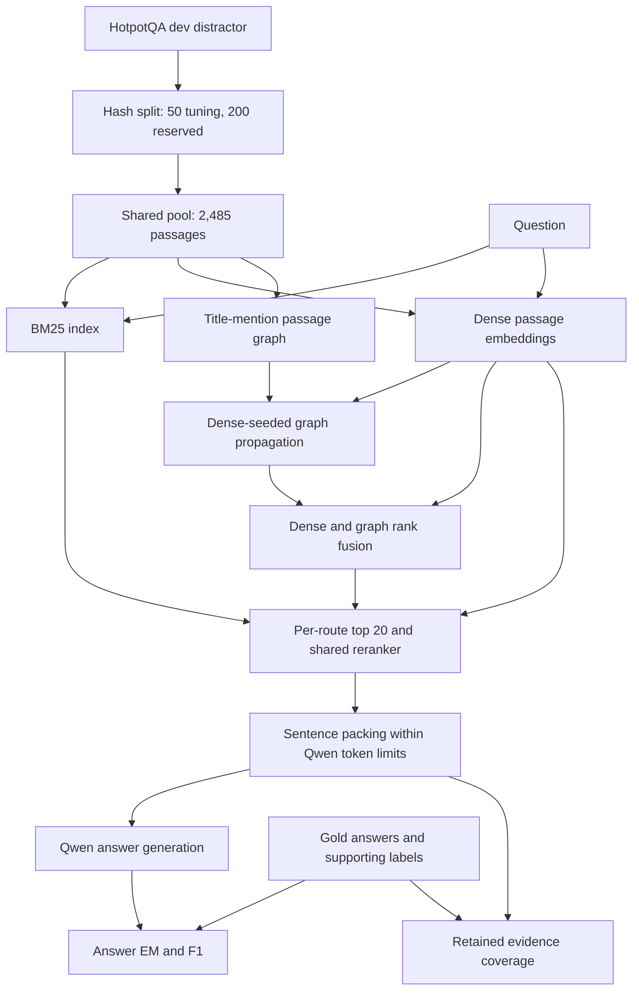

# Architecture

This is a reconstruction of the pipeline described in the author's technical report, not a code audit or a claim that the implementation is present.

## Data preparation and query flow

The three retrieval routes are separate conditions, not a merged candidate union. Gold labels are used for evaluation and for the separate privileged oracle control; they must not enter graph extraction or retrieval ranking.

## Graph construction

1. Normalize passage titles and corpus sentence text.
2. Match title mentions exactly in sentences; the manuscript specifies titles of at least four characters and word-boundary matching.
3. Retain sentence provenance for mention triples.
4. Link passages when they mention the same entity or one mentions the other's title.
5. Reject incidence groups spanning more than 30 documents.
6. Form an undirected passage projection: reported 1,362 mention triples and 3,230 edges.

This is a title-mention graph. Relation correctness, semantic entity linking and aliases were not verified. The precise normalization and edge-deduplication behavior require the original source.

## Retrieval settings

| Component | Reported setting |
| --- | --- |
| BM25 | k1=1.2, b=0.75; Unicode case-folded words, positive IDF; no stemming or stop list |
| Dense encoder | sentence-transformers/all-MiniLM-L6-v2; normalized embeddings |
| Graph seeds | Three highest-ranked dense passages |
| Seed weighting | Technical report: softmax temperature 0.1; manuscript: equal mass (unresolved discrepancy) |
| Propagation | Restart probability 0.35, 20 iterations |
| Fusion | Weighted reciprocal rank fusion; graph weight 0.5, rank offset 60; average ranks for tied scores |
| Candidate budget | Top 20 from each route, evaluated separately |
| Reranker | cross-encoder/ms-marco-MiniLM-L6-v2 |

Do not infer exact restart handling, dangling-node behavior or fusion implementation from this summary. These require source recovery. Weight 0.5 reportedly comes from tuning rather than reserved-answer selection, with a packing-tokenizer change between pilot and final evaluation.

## Shared packing and generation

| Parameter | Reported value |
| --- | --- |
| Packing | Whole sentences |
| Maximum passages | 5 |
| Maximum tokens per passage | 256 Qwen tokens |
| Maximum context tokens including headers | 1,024 Qwen tokens |
| Tokenizer | Read from the generator GGUF |
| Generator | Qwen2.5-7B-Instruct, Q4_K_M |
| Runtime | llama.cpp b9672, short commit 74ade5274, Windows x64 |
| CPU threads / GPU layers | 4 / 20 Vulkan-offloaded layers |
| GPU | RTX 3050 Ti Laptop, 4 GB VRAM |
| Model context | 4,096 tokens |
| Logical / physical batch | 512 / 128 |
| Output | Greedy, grammar-constrained JSON with one answer field |
| Maximum generated tokens | 128 |

Retrieved conditions share an evidence-only instruction; closed book uses a different prior-knowledge instruction. Oracle context contains all annotated supporting sentences and shares the evidence instruction, but is not matched to retrieved context length.

The exact prompt templates, chat formatting and grammar file are unavailable in this release, so the tables are not a complete executable specification.
